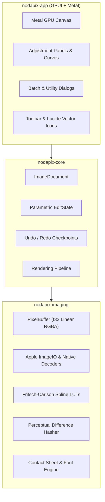

# NodaPix

NodaPix is a fast, native macOS image viewer and non-destructive photo editor written in Rust. Built on [GPUI](https://github.com/zed-industries/zed) and Apple Metal, it re-engineers the feature set of Linux Mint's Pix (and gThumb) into a modern macOS application with zero-degradation parametric edits, Apple Silicon hardware decoding, and clean AppKit integration.

---

## Architecture Overview

NodaPix is structured as a three-crate Cargo workspace separating image algorithms, document state, and the macOS graphical user interface:

```
nodapix/
├── crates/
│   ├── nodapix-imaging/    # Pure-Rust image processing & Apple ImageIO codecs
│   ├── nodapix-core/       # Parametric edit state, document model & history
│   └── nodapix-app/        # GPUI interface, Metal viewport, panels & modals
└── bundle/                 # macOS .app bundler, Info.plist, and icon generator
```



### 1. Non-Destructive Parametric Pipeline
Edits are never applied destructively to the source raster. Instead, every operation (exposure, temperature, curves, crop, straighten, sharpen) is stored as lightweight parameters in `EditState`.
- **Interactive Feedback**: While dragging sliders or adjusting curves, NodaPix evaluates a downsampled proxy buffer at 60 FPS.
- **Export & Print**: Full-resolution renders execute across all CPU cores via Rayon in 32-bit linear float space before tone-mapping to sRGB.

### 2. Apple Silicon & macOS Integration
- **Apple ImageIO Framework**: Hardware-accelerated decoding for Apple HEIC/HEIF photos, Apple ProRAW, and digital camera RAW formats (DNG, CR2, NEF, ARW).
- **Metal GPU Canvas**: Smooth trackpad pan, pinch-to-zoom, and 1:1 pixel inspection backed by Metal textures.
- **Color Profile Matching**: Automatic sRGB hardware-calibrated color space conversion using `kCGColorSpaceSRGB`.
- **Lucide Vector Icons**: 37 resolution-independent SVG vector icons rendered directly through GPUI text styling. Zero emojis or platform font dependencies.

---

## Key Features

### Interactive Editing Tools
- **Horizon Straighten Tool**: Click and drag across a waterline or architectural edge. Calculates $\theta = -\text{atan2}(\Delta y, \Delta x)$ and rotates with inscribed autocropping.
- **Eyedropper White Balance**: Interactive canvas loupe displaying RGB, HEX, and sRGB values. Neutralizes color casts from sampled gray patches.
- **Red-Eye Removal**: Click on pupil flash reflections. Neutralizes pixels exceeding the red chromaticity ratio while preserving specular reflections and edge feathering.
- **Crop Composition Overlays**: Eight draggable handles with ratio locking (Free, 1:1, 3:2, 4:3, 16:9, 16:10, Original) and guide overlays (Rule of Thirds, Golden Ratio, Crosshairs, Diagonal).

### Tonal Control & Creative Grading
- **Spline Tone Curves Editor**: Fritsch-Carlson monotonic cubic spline curves for Composite RGB, Red, Green, and Blue channels over a live 256-bin histogram. Eliminates overshoot and ringing artifacts.
- **Auto Levels**: Automatic 0.5% dynamic range histogram stretch.
- **Grayscale Conversion**: Dedicated algorithms for ITU-R BT.709 Luminance, Desaturation, and Uniform Average.
- **Filter Suite**: Vintage, Lomo, Sepia, Warm Gold, Cool Nordic, and Vivid presets alongside 3-pass box-blur unsharp masking (USM) and radial vignettes.

### Viewer & Presentation
- **Fullscreen Presentation Mode (`F11`, `Cmd+Ctrl+F`)**: Pitch-black borderless display with an auto-hiding frosted glass navigation HUD pill.
- **Automated Slideshow (`Space`)**: Non-blocking background timer ticker with configurable advance intervals (1s–30s).
- **Folder Filmstrip Carousel (`F8`)**: Asynchronous background thumbnail cache for rapid browsing across folders.
- **Visual Compare Mode (`Shift+\`)**: Instant A/B toggle between edited draft and raw original.

### Batch Operations & File Utilities
- **Batch Format Converter (`Cmd+Shift+C`)**: Converts image folders to JPEG, PNG, WebP, or TIFF with custom quality and background progress bars. Preserves camera EXIF metadata.
- **Batch Series Renaming (`Cmd+Shift+R`)**: Pattern renamer supporting `#` padding (`###`), printf formats (`%04d`), original stems (`%F`), extensions (`%E`), dates (`%Y%m%d`), and case transformations with a live preview table.
- **Batch EXIF Date Adjuster**: In-place timezone correction and timestamp offsetting using Howard Hinnant's civil date algorithm.
- **Perceptual Duplicate Finder (`Cmd+Shift+D`)**: 64-bit difference hash (`dHash`, $9 \times 8$ luminance gradient, Hamming distance $\le 5$) and exact byte matching to group, inspect, and prune duplicates.

### Publishing & Export
- **Contact Sheet Generator**: Multi-column and multi-row thumbnail compilations exported at 4:3, 3:2, 1:1, or 16:9 resolutions. Features built-in 8×8 raster typography for filenames and headers across White, Dark Slate, or Black themes.
- **Native macOS Print Sheet (`Cmd+P`)**: Virtual paper preview with margin controls, orientation switching (Auto, Portrait, Landscape), scaling modes (Fit, Fill, 100%), and direct integration with macOS Cocoa/AppKit printing.
- **EXIF Preservation**: Verbatim raw camera metadata block re-embedding on export with normalized orientation tags.

---

## Keyboard Shortcuts

| Shortcut | Action |
|:---|:---|
| **`Cmd + O`** | Open Image File Dialog |
| **`Cmd + S`** | Save In-Place (Atomic replacement) |
| **`Cmd + Shift + S`** | Export Image Sheet |
| **`Cmd + Alt + S`** | Save As New File |
| **`Cmd + P`** | Print via Native macOS Dialog |
| **`Cmd + Z`** / **`Cmd + Shift + Z`** | Undo / Redo Checkpoint |
| **`Cmd + +`** / **`Cmd + -`** | Zoom In / Zoom Out |
| **`Cmd + 0`** / **`Cmd + 1`** | Fit to Window / 100% Actual Size |
| **`Cmd + [`** / **`Cmd + ]`** | Lossless Rotate 90° CCW / CW |
| **`Shift + H`** / **`Shift + V`** | Flip Horizontal / Flip Vertical |
| **`C`** | Toggle Interactive Crop Tool |
| **`Enter`** / **`Escape`** | Apply Crop / Cancel Crop or Close Modal |
| **`Shift + \`** | Hold or Toggle Original vs Edited Compare |
| **`Cmd + Backspace`** | Reset All Adjustments to Default |
| **`Cmd + I`** | Toggle EXIF Metadata Inspector Modal |
| **`Cmd + U`** | Auto Enhance Levels |
| **`Cmd + R`** | Resize Image Dimensions Dialog |
| **`F8`** | Toggle Thumbnail Carousel Filmstrip |
| **`F11`** / **`Cmd + Ctrl + F`** | Toggle Fullscreen Presentation Mode |
| **`Space`** | Play / Pause Slideshow |
| **`Cmd + Shift + C`** | Open Batch Format Converter |
| **`Cmd + Shift + R`** | Open Batch Series Renamer |
| **`Cmd + Shift + D`** | Open Duplicate Image Finder |
| **`Left Arrow`** / **`Right Arrow`** | Previous Image / Next Image |

---

## Building from Source

### Prerequisites
- macOS 12.0 (Monterey) or higher
- Apple Silicon (M1/M2/M3/M4) or Intel Mac
- Rust 1.80+ (`curl --proto '=https' --tlsv1.2 -sSf https://sh.rustup.rs | sh`)
- Xcode Command Line Tools (`xcode-select --install`)

### Run Development Build
```bash
git clone https://github.com/noda/nodapix.git
cd nodapix

# Run the editor
cargo run -p nodapix-app

# Run with a target image
cargo run -p nodapix-app -- path/to/photo.jpg
```

### Run the Test Suite
All crates include comprehensive integration and unit tests covering image filters, civil dates, tone curves, and codec integrity:

```bash
cargo test --workspace
```

### Build Standalone macOS App Bundle
The repository includes a packaging script that compiles release binaries with optimizations, generates multi-resolution Retina iconsets (`.icns`), packages the bundle structure, and applies ad-hoc codesigning:

```bash
./bundle/build_app.sh
```

The compiled application bundle will be located at:
```
nodapix/target/bundle/NodaPix.app
```

You can move `NodaPix.app` to your `/Applications` folder or launch it directly via Spotlight / Terminal:
```bash
open target/bundle/NodaPix.app
```

---

## License

NodaPix is dual-licensed under either:
- **MIT License** ([LICENSE-MIT](LICENSE-MIT))
- **Apache License, Version 2.0** ([LICENSE-APACHE](LICENSE-APACHE))

Original UI workflows and algorithms inspired by [Linux Mint Pix](https://github.com/linuxmint/pix) and [gThumb](https://gitlab.gnome.org/GNOME/gthumb).
Vector icons provided by [Lucide](https://lucide.dev) under the ISC License.
Metal UI infrastructure powered by [GPUI](https://github.com/zed-industries/zed) (Apache 2.0).
